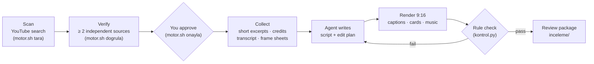

[English](README.md) · [Türkçe](README.tr.md)

# GTA 6 Easter Egg Shorts Engine

**New GTA 6 easter egg found? This engine checks it against two sources, builds a credited vertical Short, and leaves it for your review. It never uploads.**

A shell + Python pipeline with an agent skill that works the same way in **Claude Code, Codex and Antigravity**. The scripts do the cutting, rendering and rule checks, and your coding agent writes the script and edit plan.

[](https://github.com/fornhere/gta6-easteregg-shorts/actions/workflows/checks.yml) [](LICENSE)   

## How it works



Every package goes through a **human gate twice**: once when you approve a candidate, and again when you watch the result and upload it yourself.

## Why not just clip it yourself?

| | Clipping by hand | With this engine |
|---|---|---|
| Is the easter egg real? | One video, take it or leave it | Needs ≥ 2 independent sources; mods, old games, fakes flagged |
| Credits | Easy to forget | `clip: @channel` on screen + links in the description, checked |
| Excerpt length | Whatever looks good | ≤ 4 s in a row per source, no source > 55 %, ≥ 2 sources |
| Source audio | Often left in | Always muted; your own narration and music |
| Spoilers / nudity | Noticed late | Blocklist on titles, plus frame sheets for you to check |
| Upload | Instant | Never automatic; you review first |

## Install (about a minute)

```sh
git clone https://github.com/fornhere/gta6-easteregg-shorts && cd gta6-easteregg-shorts
./install.sh
```

`install.sh` checks `python3` (3.10+), `ffmpeg`, `yt-dlp` and [`uv`](https://docs.astral.sh/uv/), prints the install command for anything missing (it never uses `sudo`), and caches the Python dependencies through `uv`. Options:

```sh
./install.sh --whisper        # also download faster-whisper now (else: on first transcription)
./install.sh --agent all      # also install the skill globally for claude, codex and antigravity
```

Transcription is bundled (`bin/transkript.py`, faster-whisper). It uses an NVIDIA GPU when one is present and the CPU otherwise.

## Use it with your agent

Open the folder in your agent and say **"run the GTA 6 easter egg Shorts engine"** (or "find new GTA 6 easter eggs"). All three load the skill from the repo:

| Agent | Start | Reads |
|---|---|---|
| Claude Code | `claude` in this folder | `CLAUDE.md` → `AGENTS.md`, `.claude/skills/` |
| Codex | `codex` in this folder | `AGENTS.md`, `.agents/skills/` |
| Antigravity | open as workspace, or `agy` in this folder | `AGENTS.md`, `.agents/skills/` |

Want it from any folder? `./ajan-kur.sh all` copies the skill to `~/.claude/skills`, `~/.codex/skills` and `~/.gemini/config/skills`. `./ajan-kur.sh all --kaldir` removes only what it installed.

Text-to-speech is optional: anything that produces `isler/<job>/ses/anlatim/ham.mp3` works. The author used the Epidemic Sound MCP; add your own with `claude mcp add`, `codex mcp add` or `agy mcp add`.

## Run it by hand

```sh
./motor.sh tara                    # scan for new easter eggs       -> kuyruk/TARAMA-*.md
./motor.sh dogrula                 # two-source rule                 -> kuyruk/ONAY.md
./motor.sh onayla <candidate_id>   # YOU approve
./motor.sh topla <job> <candidate_id>   # download, credits, transcript, frame sheets
#   agent: istemler/yaz.md (script) -> TTS -> istemler/kurgu.md (cekimler.json)
./motor.sh sik <job>               # tighten narration to ~3.5 words/s
./motor.sh zaman <job>             # word timings
./motor.sh bitir <job>             # render + rule check + package  -> inceleme/<date>-<job>/
```

Run `./motor.sh` with no arguments for the full list. Command names are Turkish. The [reference](docs/REFERANS.md) explains every command, rule and style key.

## Scheduler (off by default)

A systemd timer template scans three times a day. It produces videos only if you pick an agent:

```sh
GTA6_AJAN=codex ./motor.sh oto        # or claude / antigravity; one manual run
```

The [reference](docs/REFERANS.md#zamanlayıcı-varsayılan-kapalı) covers installing the timer. It never approves candidates and never uploads.

## Copyright habits (read this)

- Credit the discoverer: `clip: @channel` on screen, with the channel and link in the description and pinned comment.
- Use short excerpts only, mute the source audio, never use in-game radio music, and add your own narration, captions and analysis layers.
- Ask clip owners for permission: `./motor.sh izin <job>` prints the messages. **The engine never sends them; you do.**
- **Credits are not a licence.** Content ID claims or strikes can still happen. These rules are rules of thumb, not legal advice. You are responsible for what you publish.
- No spoilers, cutscenes or nudity. Look at the frames yourself.

## Limits

> **Beta.** Built and used on Linux (Arch) with an NVIDIA GPU. macOS should work but is untested, and Windows needs WSL.

- Scanning covers YouTube only. News checks happen in the agent step.
- Framing and arrow/circle positions are set by the agent from frame sheets, not detected automatically.
- The audio is measured (LUFS, freezes) but nobody listens to it except you.

## Documentation

| Guide | Language |
|---|---|
| [Reference: commands, rules, cekimler.json, style, host mode](docs/REFERANS.md) | Turkish |
| [Agent skill](.agents/skills/gta6-easteregg-shorts/SKILL.md) | Turkish |
| [Step prompts](istemler/) | Turkish |
| [Permission request template](izin/SABLON.md) | English messages, Turkish notes |

## License and issues

[MIT](LICENSE). The bundled Montserrat font is under the [SIL OFL 1.1](montaj/font/Montserrat-OFL.txt). Not affiliated with Rockstar Games. Found a problem? [Open an issue](https://github.com/fornhere/gta6-easteregg-shorts/issues).
