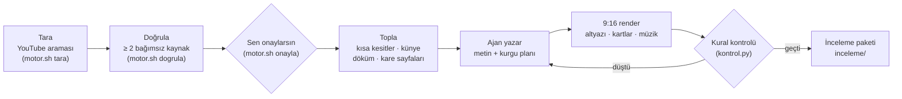

[English](README.md) · [Türkçe](README.tr.md)

# GTA 6 Easter Egg Shorts Motoru

**Yeni bir GTA 6 easter egg'i mi bulundu? Motor onu iki kaynakla doğrular, künyeli dikey bir Shorts kurar ve senin incelemene bırakır. Hiçbir şey yüklemez.**

Bir kabuk + Python hattı ve **Claude Code, Codex ve Antigravity**'de aynı şekilde çalışan bir ajan skill'i. Kesme, render ve kural kontrolünü betikler yapar. Metni ve kurgu planını kodlama ajanın yazar.

[](https://github.com/fornhere/gta6-easteregg-shorts/actions/workflows/checks.yml) [](LICENSE)   

## Nasıl çalışır



Her paket iki kez **insan kapısından** geçer: aday onayında ve sonucu izleyip kendin yüklerken.

## Elle kesmekten farkı

| | Elle kesme | Motorla |
|---|---|---|
| Easter egg gerçek mi? | Tek video, ya inanırsın ya inanmazsın | ≥ 2 bağımsız kaynak şart; mod, eski oyun, sahte işaretlenir |
| Künye | Kolayca unutulur | Ekranda `clip: @kanal` ve açıklamada link; kontrol edilir |
| Kesit uzunluğu | Göze ne hoş gelirse | Tek kaynaktan art arda ≤ 4 sn, hiçbir kaynak > %55, ≥ 2 kaynak |
| Kaynak sesi | Çoğu zaman kalır | Her zaman kapalı; kendi anlatımın ve müziğin |
| Sürprizbozan / çıplaklık | Geç fark edilir | Başlıklarda kara liste, ayrıca senin bakacağın kare sayfaları |
| Yükleme | Anında | Asla otomatik değil; önce sen incelersin |

## Kurulum (yaklaşık bir dakika)

```sh
git clone https://github.com/fornhere/gta6-easteregg-shorts && cd gta6-easteregg-shorts
./install.sh
```

`install.sh` şunları kontrol eder: `python3` (3.10+), `ffmpeg`, `yt-dlp` ve [`uv`](https://docs.astral.sh/uv/). Eksik olanın kurulum komutunu yazar (`sudo` kullanmaz) ve Python bağımlılıklarını `uv` ile önbelleğe alır. Seçenekler:

```sh
./install.sh --whisper        # faster-whisper'ı şimdi indir (yoksa ilk transkriptte iner)
./install.sh --agent all      # skill'i claude, codex ve antigravity için global olarak da kur
```

Transkript paketin içinde gelir (`bin/transkript.py`, faster-whisper). NVIDIA GPU varsa onu kullanır, yoksa CPU'da çalışır.

## Ajanınla kullan

Klasörü ajanında aç ve **"GTA 6 easter egg Shorts motorunu çalıştır"** de (ya da "yeni GTA 6 easter egg bul"). Üçü de skill'i depodan yükler:

| Ajan | Başlat | Okuduğu |
|---|---|---|
| Claude Code | bu klasörde `claude` | `CLAUDE.md` → `AGENTS.md`, `.claude/skills/` |
| Codex | bu klasörde `codex` | `AGENTS.md`, `.agents/skills/` |
| Antigravity | çalışma alanı olarak aç ya da bu klasörde `agy` | `AGENTS.md`, `.agents/skills/` |

Her klasörden çağırmak istersen `./ajan-kur.sh hepsi` skill'i `~/.claude/skills`, `~/.codex/skills` ve `~/.gemini/config/skills` altına kopyalar. `./ajan-kur.sh hepsi --kaldir` yalnız kendi kurduğunu siler.

Seslendirme isteğe bağlı: `isler/<iş>/ses/anlatim/ham.mp3` üreten her şey olur. Yazar Epidemic Sound MCP kullandı. Kendi TTS'ini `claude mcp add`, `codex mcp add` ya da `agy mcp add` ile ekleyebilirsin.

## Elle çalıştır

```sh
./motor.sh tara                    # yeni easter egg'ler           -> kuyruk/TARAMA-*.md
./motor.sh dogrula                 # iki kaynak kuralı             -> kuyruk/ONAY.md
./motor.sh onayla <aday_id>        # SEN onaylarsın
./motor.sh topla <iş> <aday_id>    # indir, künye, döküm, kare sayfaları
#   ajan: istemler/yaz.md (metin) -> TTS -> istemler/kurgu.md (cekimler.json)
./motor.sh sik <iş>                # anlatımı ~3,5 kelime/sn'ye sıkıştır
./motor.sh zaman <iş>              # kelime zamanları
./motor.sh bitir <iş>              # render + kural kontrolü + paket -> inceleme/<tarih>-<iş>/
```

Tam liste için `./motor.sh`'ı argümansız çalıştır. Her komut, kural ve stil anahtarı [başvuru belgesinde](docs/REFERANS.md) anlatılıyor.

## Zamanlayıcı (varsayılan kapalı)

Bir systemd zamanlayıcı şablonu günde üç kez tarama yapar. Video üretimine yalnız sen bir ajan seçersen geçer:

```sh
GTA6_AJAN=codex ./motor.sh oto        # ya da claude / antigravity; tek elle koşu
```

Zamanlayıcının kurulumu [başvuru belgesinde](docs/REFERANS.md#zamanlayıcı-varsayılan-kapalı). Aday onaylamaz, yükleme yapmaz.

## Telif alışkanlıkları (oku)

- Keşfedeni an: ekranda `clip: @kanal`, açıklamada ve sabit yorumda kanal ile link.
- Yalnız kısa kesitler kullan. Kaynak sesini kapat, oyun içi radyo müziği kullanma. Kendi anlatımını, altyazını ve analiz katmanlarını ekle.
- Klip sahiplerinden izin iste: `./motor.sh izin <iş>` mesajları yazar. **Motor göndermez; sen gönderirsin.**
- **Künye lisans değildir.** Content ID talebi ya da strike yine gelebilir. Bu kurallar genel iyi uygulamadır, hukuki tavsiye değildir. Yayınladığından sen sorumlusun.
- Sürprizbozan, ara sahne ve çıplaklık olmasın. Karelere kendin bak.

## Sınırlar

> **Beta.** Linux'ta (Arch) NVIDIA GPU ile geliştirildi ve kullanıldı. macOS'ta çalışması beklenir ama denenmedi. Windows'ta WSL gerekir.

- Tarama yalnız YouTube'u kapsar. Haber doğrulaması ajan adımında yapılır.
- Kadraj ve ok/daire konumlarını ajan kare sayfalarından belirler; otomatik algılanmaz.
- Ses ölçülür (LUFS, donma) ama senden başka dinleyen yoktur.

## Belgeler

| Belge | Dil |
|---|---|
| [Başvuru: komutlar, kurallar, cekimler.json, stil, sunucu kipi](docs/REFERANS.md) | Türkçe |
| [Ajan skill'i](.agents/skills/gta6-easteregg-shorts/SKILL.md) | Türkçe |
| [Adım talimatları](istemler/) | Türkçe |
| [İzin isteme şablonu](izin/SABLON.md) | İngilizce mesajlar, Türkçe notlar |

## Lisans ve sorunlar

[MIT](LICENSE). Pakete dahil Montserrat fontu [SIL OFL 1.1](montaj/font/Montserrat-OFL.txt) lisanslıdır. Rockstar Games ile bağlantısı yoktur. Sorun mu buldun? [Issue aç](https://github.com/fornhere/gta6-easteregg-shorts/issues).
